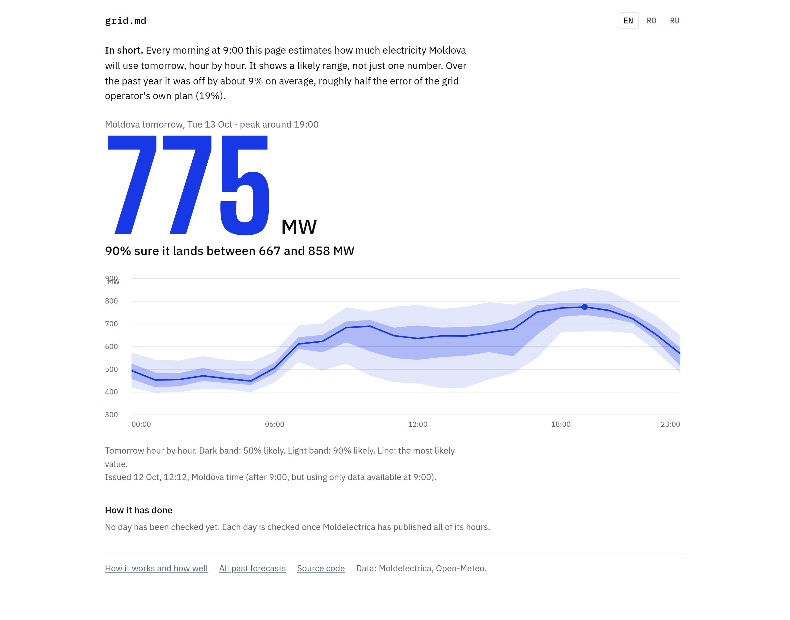

# grid.md

Every morning at 09:00 Moldova time, a forecast of how much electricity Moldova will use
tomorrow, hour by hour, given as a range rather than one number and checked against the grid
operator's own plan. The page is in English, Romanian and Russian.



**Live: [iliev-blnk.github.io/grid.md](https://iliev-blnk.github.io/grid.md/)**

## Result

Backtest over one test year (Oct 2025–Sep 2026, 8,693 hours), with the design fixed
beforehand ([full report](research/REPORT.md)):

| | typical error (MAPE) | hours inside the 90% range |
| --- | ---: | ---: |
| grid.md | **8.6%** | 88.4% |
| Moldelectrica's own plan | 18.7% | – |
| the plan with its recent bias removed | 15.5% | – |
| same hour last week | 15.0% | 89.1% (range 1.8× wider) |

- Most of the gap comes from spring and summer. Moldelectrica's load is consumption net of
  distributed solar, and on sunny afternoons it falls by half; only a forecast that sees
  tomorrow's sunshine follows it.
- In winter the operator's plan is as good as or slightly better than the model.

## How it works

- **Data:**
  - Moldelectrica's public 15-minute archive (load, plan, generation, flows), from 2021.
  - Open-Meteo archived weather forecasts for Chișinău, Bălți, Cahul and Ungheni.
  - Quirks found along the way are in [`research/DATA_FACTS.md`](research/DATA_FACTS.md).
- **No hindsight:**
  - The forecast for D+1 is built at 09:00 on D only from data that existed then: load hours
    that ended by 08:00, and weather forecasts already issued.
  - A test checks the weather rule on every row.
  - The operator's plan is never an input.
- **Model:**
  - LightGBM quantile regression (7 quantiles) of *load minus the same hour last week*.
  - Features: calendar, Moldovan holidays, recent load, weather, and a 14-day estimate of how
    strongly sunshine currently cuts net load.
  - A rolling conformal correction keeps the ranges honest as the system changes.
  - Design choices were made on a separate validation half-year
    ([`research/VALIDATION.md`](research/VALIDATION.md)) and pinned before the test year was
    scored.
- **Every day:**
  - A systemd timer on my machine runs [`scripts/daily.sh`](scripts/daily.sh): refresh data,
    retrain monthly, issue tomorrow's forecast, score finished days, commit and push. It runs
    locally because Moldelectrica blocks cloud runners.
  - Forecasts in [`forecasts/`](forecasts/) are committed before the day starts and never
    edited. Scores land in [`scores/`](scores/).

## Run it

```sh
python -m venv .venv && .venv/bin/pip install -e ".[dev]"
.venv/bin/gridmd ingest load --from 2021-12-01     # Moldelectrica → data/load.csv.gz
.venv/bin/gridmd ingest weather --from 2022-01-01  # Open-Meteo → data/weather.csv.gz
.venv/bin/gridmd backtest dataset|tune|test        # research/
.venv/bin/gridmd retrain --force && .venv/bin/gridmd forecast --date 2026-10-12
.venv/bin/pytest -q && pnpm install && pnpm --dir site dev
deploy/install.sh                                   # the daily systemd user timer
```

Data: [Moldelectrica](https://moldelectrica.md/) operative data;
[Open-Meteo](https://open-meteo.com/) (CC BY 4.0). MIT licence.
