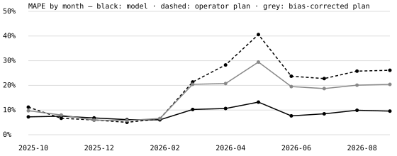
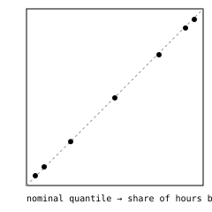

# grid.md backtest — Moldova load, day ahead

**Question.** At 09:00 Moldova time on day D, how well can tomorrow's hourly national
electricity load be forecast, as a median and as a range, compared with Moldelectrica's own
plan?

**Answer (one test year, used once).** Over 8,693 hours from October 2025 to September 2026:

- **Median error:** the model's MAPE is **8.6%**, against **18.7%** for
  the operator's plan, 54% lower. The bias-corrected plan scores 15.5% and
  the same hour last week 15.0%.
- **Ranges:** the 90% range covers **88.4%** of hours (80%: 78.6%).
- **Winter caveat:** from November to January the plan is as good as or slightly better than
  the model.

## Setup

- **Data.**
  - Moldelectrica's operative archive, 15-min, 2021-12..2026-10: load, the operator's plan,
    generation and flows. `DATA_FACTS.md` has the details: timestamp convention, DST, the 2025
    regime change, outages, and the plan's upward bias.
  - Open-Meteo archived forecasts for Chișinău, Bălți, Cahul and Ungheni, population-weighted.
- **Leakage rules.**
  - The forecast for D+1 is made at 09:00 on D.
  - Load actuals are used only for hours that ended by 08:00 on D.
  - Weather comes only from forecasts that existed at 09:00. For each hour the model uses the
    freshest of the 24/48/72-hour-ahead predictions made by then. A test checks this on every
    row.
  - The operator's plan is never an input, because it is not visible before the day.
- **Model.**
  - LightGBM quantile regression (7 quantiles) on *load minus the same hour last week*.
  - Features: calendar and holidays, recent lags, weather, radiation on the lag days, and a
    14-day estimate of how strongly sunshine currently cuts net load. Moldelectrica's load is
    net of distributed solar, and that capacity is growing.
  - A rolling conformal correction shifts each quantile by its own errors over the previous 8
    weeks.
  - Settings: 15 leaves, learning rate 0.03, 100 minimum leaf size, 638 trees.
- **Protocol.**
  - Hyperparameters and design were chosen on April–September 2025 only (`VALIDATION.md`) and
    pinned in commit c861e3a before the test year was scored.
  - The test refits monthly on everything observed before each month, starting January 2025 so
    the conformal step has history; only October 2025 onwards is scored.
  - Benchmarks are scored on the same hours: 8,693 scored, 10 skipped because last week's value
    was missing in an archive outage.

## Results

| | MAPE | MAE (MW) | pinball | 80% cover | 90% cover | 90% width (MW) |
| --- | ---: | ---: | ---: | ---: | ---: | ---: |
| model | **8.6** | **46.9** | **14.0** | 0.786 | 0.884 | 202 |
| model without the conformal step | 8.6 | 46.5 | 14.3 | 0.671 | 0.780 | 155 |
| same hour last week + error quantiles | 15.0 | 82.4 | 25.5 | 0.778 | 0.891 | 362 |
| operator plan | 18.7 | 83.8 | – | – | – | – |
| operator plan, bias-corrected (last 28 days) | 15.5 | 75.8 | – | – | – | – |

By month (MAPE %, and the model's 90% coverage):

| month | model | plan | plan, bias-corrected | same hour last week | model 90% cover |
| --- | ---: | ---: | ---: | ---: | ---: |
| 2025-10 | 7.3 | 11.2 | 9.7 | 11.8 | 0.90 |
| 2025-11 | 7.5 | 6.7 | 8.0 | 13.9 | 0.82 |
| 2025-12 | 6.8 | 6.0 | 5.9 | 11.3 | 0.90 |
| 2026-01 | 6.1 | 5.0 | 5.8 | 9.5 | 0.88 |
| 2026-02 | 6.0 | 6.4 | 6.6 | 10.2 | 0.87 |
| 2026-03 | 10.2 | 21.4 | 20.4 | 18.0 | 0.89 |
| 2026-04 | 10.6 | 28.3 | 20.7 | 18.9 | 0.91 |
| 2026-05 | 13.2 | 40.6 | 29.5 | 21.5 | 0.88 |
| 2026-06 | 7.6 | 23.7 | 19.5 | 18.1 | 0.94 |
| 2026-07 | 8.5 | 22.8 | 18.7 | 15.4 | 0.83 |
| 2026-08 | 9.9 | 25.8 | 20.1 | 15.2 | 0.88 |
| 2026-09 | 9.6 | 26.1 | 20.4 | 16.0 | 0.91 |

Quantile reliability: the share of hours at or below each forecast quantile, which should equal
the level. 0.05: 0.056 · 0.10: 0.105 · 0.25: 0.248 · 0.50: 0.496 · 0.75: 0.740 · 0.90: 0.892 · 0.95: 0.940

## Reading it

- **The gap is a solar story.** In winter all forecasts are close (5–8%). From March the
  operator plan's error climbs to 21–41% while the model stays at 8–13%. In spring and summer,
  midday net load collapses on sunny days (it fell to 133 MW at 14:00 on Easter Sunday 2025), and
  only a forecast that sees tomorrow's sunshine follows it.
- **The plan is biased upward,** by about 50–120 MW in most months. Removing its recent bias
  helps (15.5%) but is not enough.
- **The conformal step costs almost nothing in MAPE** (8.6 vs 8.6) and turns an overconfident
  range (78% coverage for a nominal 90%) into a nearly honest one (88%).
- **Worst month: May 2026,** at 13.2%: the strongest solar month with the largest
  week-to-week changes in sunshine.

## Limits

- One test year, with strong autocorrelation within it. Monthly numbers rest on ~720 hours
  each.
- When the operator makes its plan is unknown. If it is made later than 09:00 on D the
  comparison flatters the plan; if earlier, it is unfair to the plan.
- There is no measured solar capacity. The model infers how strong the sunshine effect is from
  the last 14 days.
- Weather: four sites; archive gaps in Dec 2023 / Jan 2024.
- The Romanian price forecast in the original plan is deferred: the only free source's licence
  forbids public use.
- Live forecasts since 2026-10-13 are scored in `scores/`, separately from this backtest.
