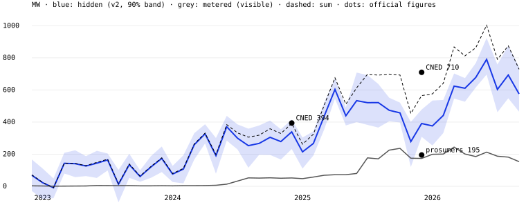

# Moldova's hidden solar

**Question.** How much solar capacity does Moldova have that the grid operator does not meter,
such as rooftop prosumers and small parks on the local distribution grid? Moldelectrica's
"Load" is consumption net of that solar, so its midday dips carry the answer.

**Answer.** About **668 MW** of solar the grid operator does not meter, averaged over
May–September 2026. The 90% range is 557–814 MW, before the model's own uncertainty.
On top of that comes about 184 MW that it does meter. That is roughly three times the
official prosumer figure (195 MW at the end of 2025).

## Method

- **Weather.** Actual hourly weather from Open-Meteo's ERA5 archive at six sites (Chișinău,
  Bălți, Cahul, Ungheni, Comrat, Soroca), averaged with equal weights.
- **Output of 1 kW of PV** each hour: `irradiance/1000 · 0.82 · (1 − 0.004·(T_cell − 25))`.
- **Hidden capacity**, for each calendar month: regress hourly load on that month's typical
  daily shape (workday and weekend/holiday), heating and cooling degree-hours and PV output,
  with a separate level for every day. The day level absorbs how much electricity the day needs
  overall. What is left to identify the PV coefficient is how sunny and cloudy days of the same
  month bend the daytime shape. Interval: 200 bootstrap resamples of whole days.
- **Visible capacity**: Moldelectrica's metered renewables column regressed on the same PV output
  and a wind-power proxy.

## Two versions, and why

- **v1, pre-registered.** Horizontal irradiance (GHI), no other correction. It failed check (b)
  below.
- **v2, a post-hoc correction, labelled as such.** Two physical problems in v1, fixed after
  seeing the failure:
  1. **Panels are tilted.** Per installed kW they collect far more of the low winter sun than
     horizontal GHI suggests. v1 therefore *overstated* capacity, most of all in winter.
     v2 uses irradiance on a 30° south-facing plane.
  2. **Demand reacts to sunshine.** Cloudy days mean more lighting and heating, which looks the
     same as solar output. v1 already found 50–200 MW of "solar" in 2022, before the boom. v2
     measures that response in each calendar month of Dec 2021–Nov 2022 and subtracts it from
     the same month in later years. Prosumers existed in 2022 too, so this slightly
     *understates* hidden solar.

## Validation (checks fixed in the spec before results)

| check | v1 | v2 |
| --- | --- | --- |
| (a) hidden ≥ official prosumers, end 2025 (188–195 MW) | 806 MW, pass | 391 MW, pass |
| (b) hidden + visible vs CNED total, Dec 2024 (394 MW) | 794 MW, **fail (2.0×)** | 391 MW, pass (-1%) |
| (b) hidden + visible vs CNED total, Dec 2025 (710 MW) | 1,080 MW, **fail (1.5×)** | 565 MW, -20% |
| (c) a planted 300 MW is recovered within 10% | pass (unit test) | same estimator |

v2 matches CNED at the end of 2024 almost exactly and is about 20% low at the end of 2025.
Winter months have little sun to identify anything from, so their intervals are wide. The
summer months are the most reliable.

## All months (MW)

| month | v1 hidden | v2 hidden, raw | 2022 sunshine response | v2 hidden, net (90%) | visible | net + visible |
| --- | ---: | ---: | ---: | ---: | ---: | ---: |
| 2022-12 | 108 | 57 | -11 | **68** (-29–167) | 3 | 71 |
| 2023-01 | 127 | 71 | 48 | **22** (-80–111) | 2 | 24 |
| 2023-02 | 107 | 40 | 50 | **-9** (-74–48) | 1 | -8 |
| 2023-03 | 209 | 141 | -2 | **143** (80–209) | 1 | 144 |
| 2023-04 | 153 | 124 | -17 | **141** (57–224) | 2 | 143 |
| 2023-05 | 142 | 124 | -2 | **126** (64–188) | 2 | 129 |
| 2023-06 | 98 | 84 | -60 | **144** (52–221) | 5 | 149 |
| 2023-07 | 230 | 216 | 52 | **164** (99–205) | 5 | 169 |
| 2023-08 | 210 | 175 | 163 | **12** (-112–102) | 4 | 16 |
| 2023-09 | 346 | 273 | 138 | **134** (53–202) | 5 | 139 |
| 2023-10 | 189 | 123 | 62 | **61** (28–100) | 3 | 64 |
| 2023-11 | 377 | 194 | 73 | **120** (53–188) | 3 | 124 |
| 2023-12 | 299 | 162 | -11 | **174** (88–248) | 4 | 177 |
| 2024-01 | 232 | 124 | 48 | **76** (26–127) | 3 | 79 |
| 2024-02 | 271 | 157 | 50 | **107** (19–193) | 4 | 112 |
| 2024-03 | 366 | 257 | -2 | **259** (167–331) | 4 | 263 |
| 2024-04 | 397 | 310 | -17 | **326** (267–386) | 5 | 331 |
| 2024-05 | 218 | 189 | -2 | **191** (79–301) | 7 | 198 |
| 2024-06 | 317 | 311 | -60 | **371** (284–439) | 13 | 384 |
| 2024-07 | 402 | 351 | 52 | **300** (229–386) | 33 | 332 |
| 2024-08 | 477 | 416 | 163 | **253** (116–359) | 53 | 306 |
| 2024-09 | 551 | 406 | 138 | **267** (196–379) | 51 | 318 |
| 2024-10 | 624 | 367 | 62 | **305** (196–410) | 53 | 358 |
| 2024-11 | 745 | 352 | 73 | **278** (167–355) | 50 | 329 |
| 2024-12 | 713 | 328 | -11 | **339** (232–416) | 52 | 391 |
| 2025-01 | 523 | 263 | 48 | **214** (110–304) | 48 | 262 |
| 2025-02 | 557 | 316 | 50 | **267** (192–343) | 57 | 324 |
| 2025-03 | 635 | 434 | -2 | **437** (354–521) | 69 | 505 |
| 2025-04 | 720 | 586 | -17 | **603** (546–673) | 72 | 675 |
| 2025-05 | 488 | 437 | -2 | **439** (379–491) | 72 | 511 |
| 2025-06 | 516 | 473 | -60 | **533** (400–708) | 80 | 613 |
| 2025-07 | 603 | 572 | 52 | **521** (382–692) | 177 | 698 |
| 2025-08 | 777 | 684 | 163 | **521** (366–637) | 171 | 692 |
| 2025-09 | 848 | 612 | 138 | **474** (405–552) | 225 | 699 |
| 2025-10 | 805 | 519 | 62 | **457** (397–521) | 236 | 693 |
| 2025-11 | 633 | 352 | 73 | **279** (120–401) | 175 | 453 |
| 2025-12 | 806 | 380 | -11 | **391** (308–478) | 174 | 565 |
| 2026-01 | 873 | 424 | 48 | **376** (254–534) | 199 | 575 |
| 2026-02 | 752 | 491 | 50 | **441** (332–538) | 201 | 642 |
| 2026-03 | 994 | 622 | -2 | **624** (546–703) | 244 | 868 |
| 2026-04 | 744 | 594 | -17 | **611** (527–674) | 201 | 812 |
| 2026-05 | 755 | 676 | -2 | **678** (615–767) | 185 | 863 |
| 2026-06 | 790 | 730 | -60 | **790** (696–923) | 213 | 1003 |
| 2026-07 | 718 | 655 | 52 | **603** (461–758) | 187 | 790 |
| 2026-08 | 1005 | 856 | 163 | **693** (548–876) | 182 | 875 |
| 2026-09 | 965 | 714 | 138 | **576** (465–744) | 153 | 729 |

## Limits

- One simple PV model for every installation: single tilt, south-facing, PR 0.82. Sensitivity:
  PR 0.75 / 0.90 changes capacity by about +10% / −9% (`C_pr075`, `C_pr090` in the JSON).
- The 2022 sunshine-response baseline is noisy (−60 to +163 MW by month) and assumes behaviour
  did not change.
- Six weather points with equal weights, and no map of where the panels are.
- "Hidden" means anything that lowers Moldelectrica's Load: rooftop prosumers, small parks on
  the local distribution grid, and any other unmetered generation.
- Sources for the official figures: CNED via pv-magazine (3 Mar 2026): 710 MW total at the end
  of 2025, 315.7 MW added in 2025, prosumers 195 MW. Energy Ministry / ANRE: 188.17 MW in Nov
  2025, 202.34 MW in Feb 2026.
